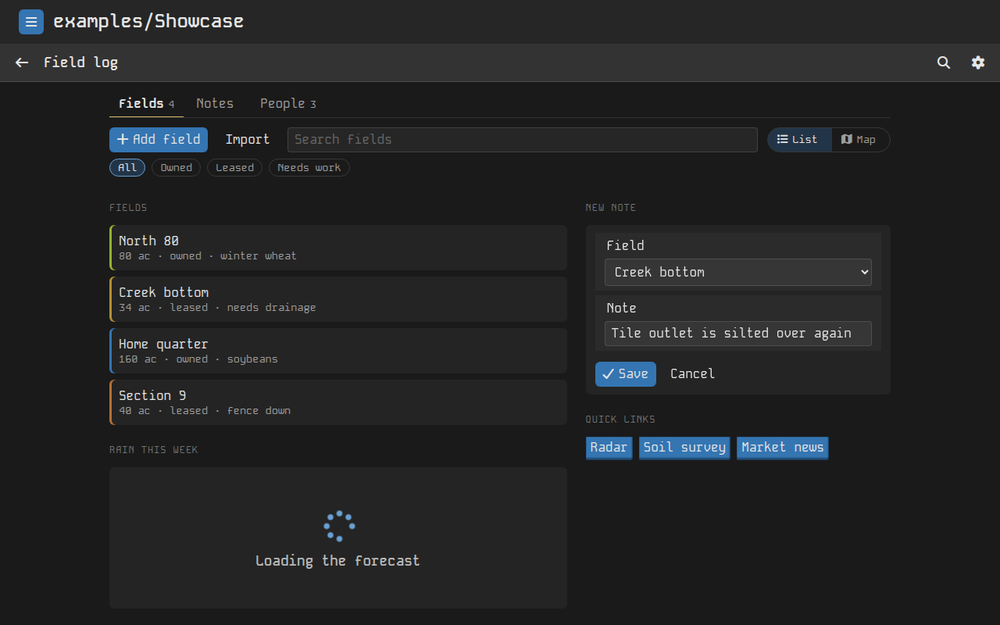
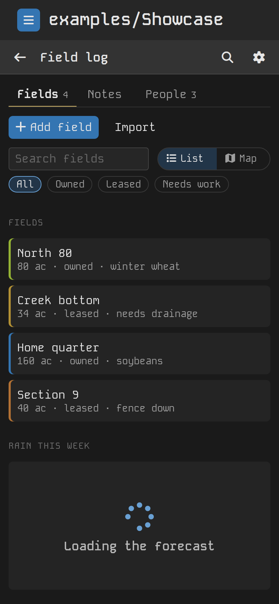
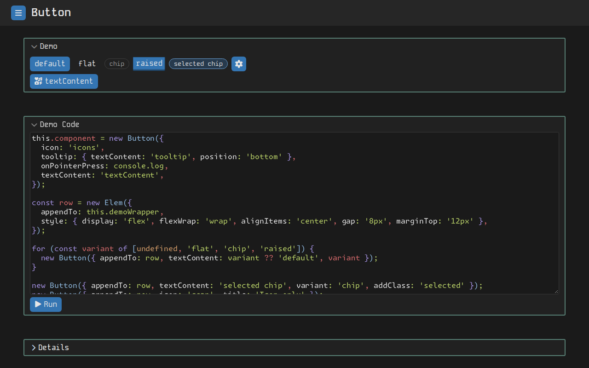

# @vanilla-bean/components

A lightweight, reactive component library for building modern web applications with vanilla JavaScript. No build steps, no framework lock-in, no virtual DOM complexity.



<p>
	
	
</p>

## Key Features

- **No build step for consumers** - Pure ES modules; import directly in browsers or bundle with any tool
- **Reactive state management** - Proxy-based, explicit; `component.options` is reactive out of the box, no dependency tracking magic
- **Scoped CSS styling** - A quiet dark theme by default (flat filled controls, hairline fields, cards a shade off the page), with shared spacing, radius and media tokens; override per-instance, per-class, or replace the theme entirely
- **Cleanup on disconnect** - no listener accumulation; components clean up after themselves
- **33 production-ready components** - A second tier of building blocks above the primitives. Button handles keyboard activation and pointer events. Dialog handles focus management and modal behavior. Form handles validation. These are composed concerns your app components build on, not reinvent.
- **Modern browser APIs** - EventTarget, Proxy, ES6 modules, native CSS nesting
- **Framework-agnostic** - works alongside Web Components, React islands, or any other approach; no conflicts, no opinions on your stack

## Philosophy

Most UI frameworks insert themselves between your code and the DOM. VDOM reconcilers, reactive dependency graphs, compile-time transforms. Each layer runs so you don't have to think about it. The trade sounds appealing until something breaks: you're debugging the framework's decisions, in execution paths that aren't yours, with failure modes that are subtle by design.

VBC is built on a different premise. The DOM is stateful, and VBC accepts that and works with it directly. When data changes, you decide what updates, through `_setOption` handlers you write. Structure lives in `build()`. Data flows in through `options`. Updates happen exactly where you put them. No reconciliation loop. No dependency graph. No rerender cascade.

This is a position, not a limitation. Automatic systems don't eliminate complexity. They relocate it to places that are harder to reach when they break. VBC's failures are obvious: you forgot a key in `_setOption` and the UI doesn't update. You can see that immediately. The subtle failures, stale closures, dependency cycles, batching surprises, concurrent mode edge cases, belong to a different model entirely.

## Table of Contents

- [Installation](#installation)
- [Interactive Explorer](#interactive-explorer)
- [Quick Start](#quick-start)
- [Core Architecture](#core-architecture)
- [Component Library](#component-library)
- [Real-World Example](#real-world-example)
- [Browser Compatibility](#browser-compatibility)
- [Development](#development)
- [Contributing](#contributing)

## Installation

Install from GitHub:

```bash
# Using bun
bun add github:fatlard1993/vanilla-bean-components

# Using npm
npm install github:fatlard1993/vanilla-bean-components

# Using yarn
yarn add github:fatlard1993/vanilla-bean-components
```

Reactive state (`Oxject`) is included in VBC, no separate install. The HTTP examples use [hypertether](https://github.com/fatlard1993/hypertether), which is a separate package:

```bash
bun add @vanilla-bean/hypertether
```

Import in your application:

```js
import { Component, Oxject, styled } from '@vanilla-bean/components';

// Specific components
import { Button, Dialog, Calendar } from '@vanilla-bean/components';
```

## Interactive Explorer

`bun start` launches the component explorer at `http://localhost:9999` (clone first, see [Development](#development)):

- **Live option editor**: every component, every option, type-appropriate controls, updated in real time
- **Auto-generated API docs**: options tables, method signatures, event listings pulled directly from source annotations
- **14 example applications**: the Showcase page pictured above, async data tables with row actions, localStorage-backed todo, a live HTML/JS/CSS playground with iframe preview, a drawing canvas with a functioning in-game economy
- **Ancestor chain navigation**: each component shows its full inheritance (EventTarget → Elem → Component → ...) with links to each layer's documentation

The explorer is built with VBC itself. It uses the same primitives and patterns you'd use in your own app.

## Quick Start

### Basic Component Creation

Every component extends `EventTarget` and wraps an `HTMLElement`:

```js
import { Component } from '@vanilla-bean/components';

const button = new Component({
	tag: 'button',
	textContent: 'Click me',
	className: 'primary-btn',
	onPointerPress: () => alert('Hello!'),
	appendTo: document.body,
});
```

### Reactive State Management

Oxject is included in VBC. Import it alongside your components:

```js
import { Component, Oxject } from '@vanilla-bean/components';

const user = new Oxject({ name: 'Alice', online: false });

new Component({
	tag: 'div',
	textContent: user.subscriber('name', name => `Welcome, ${name}!`),
	className: user.subscriber('online', online => (online ? 'user-online' : 'user-offline')),
	appendTo: document.body,
});

// UI updates automatically
user.name = 'Bob';
user.online = true;
```

### Styled Components with Theme Integration

Create scoped, themed components:

```js
import { Component, styled } from '@vanilla-bean/components';

const Notice = styled(
	Component,
	({ colors, radius, space }) => `
	background: ${colors.alpha(colors.blue, 0.15)};
	border-left: 3px solid ${colors.blue};
	border-radius: ${radius.md};
	padding: ${space.md};

	&:hover {
		background: ${colors.alpha(colors.blue, 0.22)};
	}
`,
);

new Notice({
	append: [
		new Component({ tag: 'h3', textContent: 'Heads up' }),
		new Component({ tag: 'p', textContent: 'Scoped styles, drawn from the theme.' }),
	],
	appendTo: document.body,
});
```

### Complete Reactive Application

```js
import { Component, Oxject, styled } from '@vanilla-bean/components';

// Reactive state
const state = new Oxject({ count: 0 });

// Styled component
const Counter = styled(
	Component,
	({ colors }) => `
	display: flex;
	gap: 12px;
	padding: 16px;
	background: ${colors.dark(colors.gray)};
	border-radius: 6px;
`,
);

// Component with reactive options
new Counter({
	textContent: state.subscriber('count', count => `Count: ${count}`),
	append: [
		new Component({
			tag: 'button',
			textContent: 'Increment',
			onPointerPress: () => state.count++,
		}),
		new Component({
			tag: 'button',
			textContent: 'Reset',
			onPointerPress: () => (state.count = 0),
		}),
	],
	appendTo: document.body,
});
```

## Core Architecture

### Options-First Design Philosophy

Components configure through reactive options rather than imperative method calls:

```js
// ❌ Traditional DOM manipulation
const elem = createElement('div');
elem.classList.add('container');
elem.style.padding = '20px';
elem.textContent = 'Hello';
elem.addEventListener('click', handler);
document.body.appendChild(elem);

// ✅ Options-first approach
new Component({
	tag: 'div',
	addClass: 'container',
	style: { padding: '20px' },
	textContent: 'Hello',
	onPointerPress: handler,
	appendTo: document.body,
});
```

### Cleanup With `signal`

`component.signal` is an `AbortSignal` that aborts when the component is disconnected, destroyed or rendered again. Hand it to anything that takes one and it ends with the build that started it:

```js
class Stats extends Component {
	build() {
		window.addEventListener('resize', () => this.fit(), { signal: this.signal });
		fetch('/api/stats', { signal: this.signal })
			.then(response => response.json())
			.then(stats => this.show(stats));
	}
}
```

### Core Modules

| Module | Purpose | Key Features |
| --- | --- | --- |
| **[Component](./Component/README.md)** | Enhanced DOM elements | Lifecycle management, reactive options, automatic cleanup |
| **Oxject** | Reactive state | Proxy-based reactivity, subscriber system |
| **[styled](./styled/README.md)** | Scoped CSS | Theme integration, native CSS nesting, unique class generation |
| **[Theme](./theme/README.md)** | Design system | Color manipulation, font management, accessibility helpers |

All four are available from `'@vanilla-bean/components'` directly. For HTTP caching, [hypertether](https://github.com/fatlard1993/hypertether) is a separate install (`bun add @vanilla-bean/hypertether`).

### Theme and Tokens

The default look is quiet: controls are flat and filled, fields are translucent with a hairline border, headings are plain white, and cards lift off the page by a shade. The louder bevelled button is still there as `variant: 'raised'`, on Button and on Link.

`theme` (also handed to every `styled()` call) carries the steps the library's own components use, so an app can line up with them:

| Token | Values |
| --- | --- |
| `space` | `xs` 3px, `sm` 6px, `md` 12px, `lg` 18px, `xl` 24px |
| `radius` | `sm` 4px, `md` 6px, `lg` 8px, `pill` 999px |
| `media` | `phone` (under 768px), `wide` (768px and up), `touch` (a coarse pointer) |
| `colors` roles | `surface`, `overlay`, `muted`, `border`, `info`, `success`, `warning`, `danger`, `selected`, next to the hues (`blue`, `green`, `red`, ...) |

```js
const Panel = styled(
	Component,
	({ colors, radius, space, media }) => `
	background: ${colors.surface};
	border: 1px solid ${colors.border};
	border-radius: ${radius.lg};
	padding: ${space.lg};

	@media ${media.phone} { padding: ${space.sm}; }
`,
);
```

See [theme](./theme/README.md) for the layers of customization.

### Utilities

Plain helpers ship from the main entry too ([utils](./utils/README.md)). Among them:

- `shuffleArray(array)`, `chance(percentage)` and `weightedChance({ common: 70, rare: 30 })` for randomness
- `readStorage(key, fallback)` / `writeStorage(key, value)`: localStorage as JSON that never throws (private windows, blocked site data)
- `connectSocket(path, { onLost, onRestored })`: a WebSocket that reconnects with backoff and keeps its listeners
- `debounce(callback, delay)`, whose result has a `cancel()` for a call still waiting

### The App Server Kit

Serving an app on Bun? **[app](./app/README.md)** (`'@vanilla-bean/components/app'`) builds the client, reloads pages while you work, and serves the files the components load at runtime. A server is a few lines:

```js
// server/index.js, run with `bun --hot server/index.js` in development
import { devConsole, handleExit, serve, serveApp } from '@vanilla-bean/components/app';

const api = async request => undefined; // the app's own routes: a Response, or undefined for what isn't theirs

handleExit(); // Ctrl+C, stop requests and uncaught errors end the process the same way every time

await serve({ port: 8080, router: async request => (await api(request)) ?? serveApp(request) });

devConsole(); // in development: type `b` (or `build`) to rebuild and reload the pages, `stop` to end the server
```

`serve` refuses cross-site writes and sockets, turns thrown errors into answers, takes the hot reload socket and, in development, watches the client. The `vbc-build` bin builds the client (`client/index.html` → `client/build`) for an app's `"build"` script, and `vbc-service` runs the app as a background service.

## Component Library

33 pre-built components handle common UI patterns:

### Forms & Input

- **Input** - All HTML input types with validation, typing suggestions and file drop zones
- **Select** - Dropdown selections with search
- **RadioButton** - Radio group input
- **Form** - Form management with validation
- **FormDialog** - A form in a dialog that ends in save, delete or cancel
- **Label** - Associated labels with accessibility

### Layout & Structure

- **Page** - The app's root: the page theme, fonts and stylesheets
- **Toolbar** - A row of controls that wraps, or with `variant: 'bar'` and a `heading` a page's header bar
- **Content** - The part of a view that scrolls; `column: true` (or a width) keeps it to a centered reading column
- **Card** - A raised patch holding one record or summary, with an optional accent edge
- **Router** - Client-side navigation
- **List** - Dynamic lists with filtering
- **Table** - Data tables with sorting
- **Tabs** - A row of tabs, one selected, with optional panels and counts; `variant: 'segmented'` draws them as a pill split into its choices

### Interactive Elements

- **Button** - Action buttons: filled by default, or `variant: 'flat'`, `'chip'` or `'raised'` (the bevelled key that sinks when pressed)
- **BottomSheet** - Mobile bottom sheet with drag-to-close gesture
- **Dialog** - Modal dialogs that clean up after closing, plus `Dialog.confirm`
- **Menu** - Keyboard-navigable item lists
- **ContextMenu** - A menu that opens at a point and closes itself
- **Notify** - Toast notifications that stack in a corner and leave on their own
- **Popover** - Floating content containers
- **Tooltip / TooltipWrapper** - Contextual help and information

### Specialized Components

- **Calendar** - Date selection with events
- **ColorPicker** - Color selection interface
- **Keyboard** - Virtual keyboard input
- **Whiteboard** - Drawing and annotation canvas

### Content & Display

- **Code** - Syntax-highlighted code blocks
- **Icon** - Icon system with Font Awesome integration
- **Link** - Anchors, drawn as a link, a button, or with `variant: 'raised'` as a raised key
- **TagList** - Tag management, optionally held to a vocabulary
- **EmptyState** - What an empty list or view shows, or with `loading: true` a spinner where its icon goes
- **SectionLabel** - A quiet heading over a group

## Real-World Example

Complete user management interface with data loading and state management:

```js
import { Component, Oxject, styled } from '@vanilla-bean/components';
import { GET } from '@vanilla-bean/hypertether';

// Application state
const app = new Oxject({
	users: [],
	loading: false,
	selectedUserId: null,
});

// Styled components
const UserCard = styled(
	Component,
	({ colors }) => `
	padding: 16px;
	border: 1px solid ${colors.light(colors.gray)};
	border-radius: 6px;
	cursor: pointer;

	&:hover { background: ${colors.lightest(colors.blue)}; }
	&.selected { border-color: ${colors.blue}; }
`,
);

const LoadingSpinner = styled(
	Component,
	() => `
	display: inline-block;
	animation: spin 1s linear infinite;
	@keyframes spin { to { transform: rotate(360deg); } }
`,
);

// Data loading with automatic UI updates
async function loadUsers() {
	app.loading = true;

	const { body: users } = await GET('/api/users', {
		onResponse: ({ body }) => (app.users = body), // Auto-refresh on cache invalidation
	});

	app.users = users;
	app.loading = false;
}

// User list with conditional rendering
new Component({
	className: 'user-list',
	content: app.subscriber('loading', loading =>
		loading
			? new LoadingSpinner({ textContent: 'Loading...' })
			: app.subscriber('users', users =>
					users.map(
						user =>
							new UserCard({
								textContent: user.name,
								className: app.subscriber('selectedUserId', selectedId => (selectedId === user.id ? 'selected' : '')),
								onPointerPress: () => (app.selectedUserId = user.id),
							}),
					),
				),
	),
	appendTo: document.body,
});

loadUsers();
```

## Browser Compatibility

**Evergreen browsers only.** VBC uses native CSS nesting and requires no polyfills or transpilation:

| Feature                     | Chrome/Edge | Firefox | Safari |
| --------------------------- | ----------- | ------- | ------ |
| ES6 classes, modules, Proxy | 49+         | 18+     | 10+    |
| Native CSS nesting          | 112+        | 117+    | 16.5+  |

**Effective minimum: Chrome/Edge 112, Firefox 117, Safari 16.5** (all released in 2023).

If you need older browser support, VBC is not the right tool. The native CSS nesting requirement is not negotiable without reintroducing a build-time CSS processing step.

## Shared Tooling

The package ships the house lint, format and test setup, so an app's config files stay one line where they can:

```js
// eslint.config.cjs: the app profile adds the app's own spellcheck.config.cjs words, node and Bun globals for
// server/, scripts/, cli/ and client/build.js, and leaves JSDoc optional
module.exports = [...require('@vanilla-bean/components/eslint.app.config.cjs'), { rules: {/* the app's own */} }];

// prettier.config.cjs
module.exports = require('@vanilla-bean/components/prettier.config.cjs');

// test-setup.js (bunfig.toml: [test] preload = ["./test-setup.js"])
import '@vanilla-bean/components/test-setup.js';
```

`eslint.config.cjs` is the library's own stricter config, which the app profile builds on.

## Development

### Local Development

```bash
# Clone and install
git clone https://github.com/fatlard1993/vanilla-bean-components
cd vanilla-bean-components
bun install

# Start interactive explorer
bun start        # Component explorer at http://localhost:9999

# Run tests
bun test         # Full test suite
bun test:watch   # Watch mode for development

# Build and validation
bun run build    # Clean build with component indexing
bun run lint     # ESLint validation
bun run format   # Code formatting with Prettier
```

### Project Structure

```
vanilla-bean-components/
├── app/                # Bun app kit - serve, client build, hot reload, static serving, stores, services
├── components/         # 33 pre-built UI components
├── Component/          # Core Component class
├── Elem/               # The element wrapper Component extends
├── styled/             # Scoped styling system
├── theme/              # Design tokens and helpers
├── utils/              # Plain helpers: data, dates, storage, sockets, randomness
├── demo/               # Component explorer - live option editor, API docs, example apps
└── docs/               # Additional documentation
```

### Creating Components

Generate new components with full scaffolding:

```bash
bun run create:component MyComponent
```

This creates implementation, demo, tests, and documentation files following project patterns.

## Contributing

1. **Fork and clone** the repository
2. **Create feature branch** from `main`
3. **Follow existing patterns** - Check similar components for code style
4. **Add comprehensive tests** - Use `@testing-library/dom` patterns
5. **Update documentation** - Include README updates and demos
6. **Run validation** - `bun run lint && bun test` before submitting

See individual component READMEs for architecture patterns and implementation guidelines.

## License

MIT License - see [LICENSE](./LICENSE) file for details.

---

**[Browse Components](./components/)** • **[API Documentation](./docs/)** • **[Live Demo](./demo/)** • **[Getting Started Guide](./docs/GETTING_STARTED.md)** • **[Design Philosophy](./docs/ETHOS.md)**
